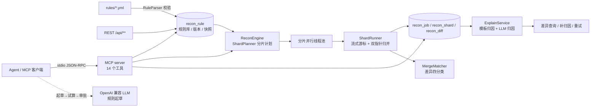

# recon-lens

<p>
  <a href="https://github.com/Dolo-w/recon-lens/actions/workflows/build.yml"></a>
  <a href="https://github.com/Dolo-w/recon-lens/releases"></a>
  
  
  
  <a href="LICENSE"></a>
</p>

**配置化的对账引擎 + 可对话的对账 Agent。**
规则即数据：用 YAML 描述"对账维度 + 要比的字段"（复合键、聚合口径、分片策略都是声明式的），提交即生效；
引擎按业务键流式归并对账，分片并行、断点重跑、差异自动分类归因；
同时是一个 MCP server —— 14 个工具把全部能力暴露给 Agent，Agent 还能**听懂一句业务描述就起草新规则、影子试算、交人审批**。

---

## 目录

- [项目介绍](#项目介绍)
- [引擎使用指导](#引擎使用指导)
- [Agent 对接指导](#agent-对接指导)
- [文档索引](#文档索引)

# 项目介绍

## 它解决什么问题

线上对账脚本通常长这样：一段硬编码 SQL + 一堆 `if`，跑出几万条差异丢给运营，然后运营来问"为什么差"。
真出事的时候更麻烦 —— 脚本跑到一半挂了只能整批重来；数据涨到千万级直接 OOM；每接一个新系统都要再写一版脚本。

recon-lens 把这件事拆成四件确定的事：

| 传统脚本 | recon-lens |
| --- | --- |
| 对账逻辑写在代码里，改规则要发版 | 规则即数据：维度与比对字段声明式描述，提交新版本经影子试算与人工审批后生效，落库前先被 DSL 校验拦一遍 |
| 全量 `SELECT` 进内存再比对 | 按业务键升序流式取数 + 双指针归并，内存与数据量无关 |
| 失败只能整批重跑 | 按分片记录进度，只重跑失败分片，重跑天然幂等 |
| 只给差异数量，原因靠人猜 | 差异自动分类 + 两级归因（离线模板兜底，可接大模型） |
| 接入新系统要再写一版脚本 | Agent 对表结构零假设：导入文件或注册表之后，一句业务描述就能起草规则 |

## 核心能力

- **规则 DSL**：`keyField` 逐笔对 / `dimension` 复合维度 / `measures` 聚合口径 / 自定义 SQL，分片策略支持取模与数值范围（`rangeKey`）
- **归并式对账**：两侧按业务键升序流式游标 + 双指针归并，千万级数据堆内存恒定（实测 `-Xmx256m` 跑 200 万×2，0 次 Full GC）
- **分片并行 + 断点重跑**：分片是并行与重试的单位，每次执行前先清本分片旧差异，幂等
- **差异分类 + 归因**：`VALUE_MISMATCH` / `MISSING_LEFT` / `MISSING_RIGHT` / `DUPLICATE_KEY` 四类语义，归因两级（规则模板 / OpenAI 兼容 LLM，LLM 失败安静降级）
- **规则库版本化**：同一个 `code` 多版本共存，任务钉住当时的规则快照，改规则不影响历史任务重跑
- **对账 Agent**（MCP）：起草规则 → 安全闸门 → 影子试算 → 人工审批 → 生效实跑，全程对话式；文件导入、动态表注册、审批代办都有工具

## 架构总览



# 引擎使用指导

## 30 秒跑起来

需要 JDK 17+。没装 Maven 就用仓库自带的 wrapper（Windows 用 `mvnw.cmd`）：

```bash
./mvnw spring-boot:run          # 或 mvn spring-boot:run
```

默认 H2 内存库自带演示数据（`bill_left` 账单 / `bill_right` 结算各 10 条，埋了 4 条差异：
金额超差、两侧重复、单边缺失各一，另有一条容差内的故意不报）和 3 条演示规则，
启动日志直接打出一份演示对账报告：

```
================ recon-lens 启动演示 ================
任务 #1 状态=SUCCESS 分片=2
扫描行数: 左侧 10 / 右侧 10，匹配 9，差异 4 条
差异分类: {AMOUNT_MISMATCH=1, DUPLICATE_KEY=1, MISSING_LEFT=1, MISSING_RIGHT=1}
----------------------------------------------------
[MEDIUM] DUPLICATE_KEY key=C005|ORD20260006 账单 2 条(id=6/9) -> 结算 2 条(id=6/9)
    归因: 业务键 C005|ORD20260006 出现重复记录（账单 2 条(id=6/9) / 结算 2 条(id=6/9)）。常见原因：重复入账或消息重放，需要按幂等键去重后重跑本分片。
[HIGH] AMOUNT_MISMATCH key=C002|ORD20260003 field=amount 1500 -> 1500.3
    归因: 账单 与 结算 的 amount 不一致：左侧 1500，右侧 1500.3，相差 -0.3（相对 0.02%）。常见原因：入账时点不同、手续费/汇率进位、撤单退单未同步、数据被人工修改。
[HIGH] MISSING_RIGHT key=C008|ORD20260009 __biz_key=C008|ORD20260009, amount=780 -> （无）
    归因: 业务键 C008|ORD20260009 在结算侧没有记录，只有账单侧有。常见原因：对方延迟入账或推送失败、我方已受理但未落库、批次边界跨天。
[HIGH] MISSING_LEFT key=C010|ORD20260011 （无） -> __biz_key=C010|ORD20260011, amount=500
    归因: 业务键 C010|ORD20260011 在账单侧没有记录，只有结算侧有。常见原因：两侧对账时间窗不一致、我方补单/同步任务漏推、对方提前入账。
----------------------------------------------------
试一下: curl http://localhost:8080/api/jobs/1
====================================================
```

```bash
./mvnw test     # 全量测试（真 H2、真 SQL、真并发）
```

## 写一条对账规则

完整 DSL 见 [docs/rule-dsl.md](docs/rule-dsl.md)，这里是最常用的三种形态：

**① 复合维度对账**（`src/main/resources/rules/bill-recon.yml`，即演示规则）：

```yaml
code: BILL_VS_SETTLE
name: 账单与结算对账（客户+订单号）
left:
  label: 账单
  table: bill_left
  keyType: STRING
  dimension: [customer_id, order_no]     # 引擎生成 CONCAT(customer_id,'|',order_no) AS __biz_key
right:
  label: 结算
  table: bill_right
  keyType: STRING
  dimension: [customer_id, order_no]

shard:                      # 分片 = 并行与断点重跑的单位
  count: 2
  parallelism: 2
  # 两侧必须按「同一个业务键口径」切分，函数用 ANSI 公共子集
  whereLeft:  "MOD(CAST(SUBSTRING(order_no, 10, 2) AS SIGNED), {shards}) = {index}"
  whereRight: "MOD(CAST(SUBSTRING(order_no, 10, 2) AS SIGNED), {shards}) = {index}"

compare:
  - field: amount
    type: DECIMAL
    tolerancePercent: 0.0001     # 小数比率：0.0001 = 0.01%
    diffType: AMOUNT_MISMATCH
    severity: HIGH

missing:                    # 单边缺失必须显式声明差异类型
  leftMissingDiffType: MISSING_LEFT
  rightMissingDiffType: MISSING_RIGHT
  severity: HIGH
duplicate: { diffType: DUPLICATE_KEY, severity: MEDIUM }
options:   { maxAttempts: 2 }
```

**② 声明式维度**（不写 SQL、不写 orderBy，示例：按客户+状态聚合）：

```yaml
left:
  table: bill_left
  keyType: STRING
  dimension: [customer_id, status]       # 引擎生成 CONCAT(customer_id,'|',status) AS __biz_key，按它升序
# 加 measures 即聚合维度：
#   measures: { amount: "SUM(amount)", order_count: "COUNT(*)" }
```

**③ 范围分片**（数值主键大表走索引的推荐切法）：

```yaml
shard:
  count: 8
  rangeKey: biz_id       # 仅数值列；引擎探两侧 MIN/MAX 生成 col >= lo AND col < hi 半开区间，末段 <= hi
```

关键约束：

- `dimension` 与 `keyField` 二选一；配了 `measures` 就必须聚合比对，`compare` 字段必须是 `measures` 别名
- 两侧分片口径必须按**同一业务键**切，不能各按自己的代理主键切（否则同一笔业务劈到不同分片，凭空多出假缺失）
- 分片谓词里的函数会被校验：`HASH()` 这类 MySQL 不存在的函数在提交时直接拒绝（`NON_PORTABLE_FUNCTION`），改用 `MOD(CRC32(...), {shards})`
- 容差 `tolerance` 是绝对值，`tolerancePercent` 是**小数比率**（0.001 = 0.1%）

## 提交规则与发起对账（REST）

```bash
# 提交一版新规则（code 相同=升级版本）
# 注意：这是运维 legacy 直写通路 —— 默认关闭，需开 recon.rules.legacy-define-enabled 并带
# X-Api-Key，提交即生效（跳过审批）；MCP 的 recon_define_rule 则一律落草稿 + 试算 + 审批
curl -X POST http://localhost:8080/api/rules \
     -H 'Content-Type: application/yaml' -H 'X-Operator: alice' -H 'X-Api-Key: <review.api-key>' \
     --data-binary @src/main/resources/rules/bill-recon.yml

# 发起对账（sync=true 同步等结果）
curl -X POST http://localhost:8080/api/jobs \
     -H 'Content-Type: application/json' \
     -d '{"ruleCode":"BILL_VS_SETTLE","batchId":"2026-10-17","sync":true}'

# 查结果
curl http://localhost:8080/api/jobs/1
curl "http://localhost:8080/api/diffs?jobId=1&limit=50"
curl "http://localhost:8080/api/diffs/summary?jobId=1"
```

| 方法 | 路径 | 说明 |
| --- | --- | --- |
| POST | `/api/jobs` | 发起对账；也可带 `rule` / `ruleYaml` 内联一份不落库的规则试算 |
| GET | `/api/jobs` / `/api/jobs/{id}` | 任务列表 / 详情（分片状态 + 差异分类汇总） |
| POST | `/api/jobs/{id}/retry?onlyFailed=true` | 断点续跑（按任务自带的规则快照） |
| GET | `/api/diffs` / `/api/diffs/summary` | 差异分页 / 汇总 |
| POST | `/api/diffs/{id}/explain`、`/api/diffs/explain?jobId=1` | 单条 / 批量归因 |
| GET | `/api/rules`、`/api/rules/{code}` | 规则库列表 / 版本历史 |
| POST | `/api/rules` | 提交一版新规则（`X-Operator` 记操作人） |
| DELETE | `/api/rules/{code}` | 停用规则（版本保留，历史任务仍可按快照重跑） |
| POST | `/api/models/{ruleCode}?shards=4` | 预处理物化：大表按规则粒度算成模型表并注册 `<CODE>__MODEL` 规则 |
| GET | `/api/models` | 已物化的模型表清单 |

> 提示：运行时提交规则 = 运行时改 SQL，生产上这个入口要挂在网关鉴权后面。

## 生产部署（MySQL）

复用你已有的 MySQL 8 实例即可（本项目对实例无特殊要求），不用新装数据库：

```bash
# 1. 建库 + 建表（在已有实例上执行）
mysql -h <你的实例> -u <用户名> -p -e "CREATE DATABASE IF NOT EXISTS recon_demo DEFAULT CHARSET utf8mb4"
mysql -h <你的实例> -u <用户名> -p recon_demo < src/main/resources/schema-mysql.sql

# 2. 启动，连接参数指向你的实例
./mvnw spring-boot:run -Dspring-boot.run.profiles=mysql \
  --spring.datasource.url="jdbc:mysql://<你的实例>:3306/recon_demo?useUnicode=true&characterEncoding=utf8&serverTimezone=Asia/Shanghai&useCursorFetch=true&rewriteBatchedStatements=true&useSSL=false" \
  --spring.datasource.username=<用户名> --spring.datasource.password=<密码>
```

- 表结构给 DBA 执行 `src/main/resources/schema-mysql.sql`（MySQL 8.0.29 空库连跑两遍验证通过）
- 连接参数已带 `useCursorFetch=true`（否则驱动会把结果集整体拉进内存，流式取数形同虚设）与 `rewriteBatchedStatements=true`
- 连接池默认 24：每个分片同时持左右两个游标，池子至少要 `2 × recon.engine.parallelism`，否则会出现"全在等连接"的假慢（实测慢 6~11 倍）
- 大表灌数用 `tools/parallel-load.mjs`（N 并发 + 先灌数后建索引，200 万行实测 168.7s）
- 规则目录可挂 `file:./rules/` 当种子来源；`recon.seed-rules: false` 可关

性能数字（百万级 H2 一键复现 + 独立 MySQL 2M×2 真机、`-Xmx256m`）与调优结论见 [docs/benchmark.md](docs/benchmark.md)，
一句话版：**分片只影响耗时，不影响结果**；函数谓词切分每片全表扫，把分片桶做成索引列（或用 `rangeKey` 范围分片）才能真提速。

# Agent 对接指导

把 recon-lens 接进你的 AI 助手（Claude Desktop / Cursor / Cherry Studio / 任何支持 stdio MCP 的宿主），
就能对话式完成：**导入数据 → 起草规则 → 影子试算 → 人工审批 → 生效实跑 → 差异归因**。

Agent 是两层 LLM 分工：宿主的大模型负责"听懂需求 + 组织工具调用"，recon-lens 内置的 LLM（任意 OpenAI 兼容端点）负责"起草规则 JSON"。
Agent 对表结构零假设 —— 全部结构信息来自表白名单 + 数据库元数据，规则落库前要过安全闸门和影子试算。

## 第 0 步：准备

| 组件 | 说明 |
|---|---|
| JDK 17+ | 打包与运行 |
| MySQL 8 | **直接复用已有实例，不要新装**。只需：① 建一个空库（如 `CREATE DATABASE recon_demo`）；② 执行 `src/main/resources/schema-mysql.sql`。没有 MySQL 才需要装一个；没有库表也可以直接用文件导入（见第 3 步） |
| 打包 | `mvn -DskipTests package` → `target/recon-lens-0.1.0.jar` |
| LLM 端点 | ① 任意 OpenAI 兼容端点（DeepSeek / OpenAI / 本地 vLLM）；② 本地 Mock 验链路：`node tools/mock-llm.mjs 8123` |

## 第 1 步：注册 MCP 连接器

在你的 MCP 客户端配置里加（以 Web 实例 + MCP stdio 双进程、共享同一个库为例）：

```json
{
  "mcpServers": {
    "recon-lens": {
      "command": "java",
      "args": [
        "-jar", "/绝对路径/recon-lens-0.1.0.jar",
        "--spring.profiles.active=mcp",
        "--recon.agent.enabled=true",
        "--recon.llm.enabled=true",
        "--recon.llm.base-url=https://api.deepseek.com/v1",
        "--recon.llm.api-key=<你的 key>",
        "--recon.llm.model=deepseek-chat",
        "--recon.review.api-key=<审批接口密钥>",
        "--recon.review.token-secret=<审批令牌密钥>",
        "--recon.agent.schema.tables=bill_left,bill_right"
      ],
      "env": {
        "RECON_SQL_INIT": "never",
        "SPRING_DATASOURCE_URL": "jdbc:mysql://127.0.0.1:3307/recon_agent_verify?useUnicode=true&characterEncoding=utf8&serverTimezone=Asia/Shanghai&useCursorFetch=true&rewriteBatchedStatements=true&allowPublicKeyRetrieval=true&useSSL=false",
        "SPRING_DATASOURCE_USERNAME": "root",
        "SPRING_DATASOURCE_PASSWORD": "",
        "SPRING_DATASOURCE_DRIVER_CLASS_NAME": "com.mysql.cj.jdbc.Driver"
      }
    }
  }
}
```

参数语义（都是实测踩过的坑）：

- **`SPRING_DATASOURCE_URL/USERNAME/PASSWORD` 换成你已有 MySQL 实例的连接信息**——示例里的 `127.0.0.1:3307/recon_agent_verify` + root 空密码只是文档作者开发机的环境，照抄连不上不代表需要新装数据库；
- `--recon.agent.enabled=true`：不开则起草链路整个不存在，只有基础工具；
- `--recon.agent.schema.tables`：**表白名单，fail-closed** —— 不配等于拒绝所有规则；后续可用工具动态注册，不必重启；
- `--recon.llm.enabled=true` + api-key：只配 base-url 不开 enabled 会被判"LLM 未配置"直接转人工；
- `--recon.review.api-key` + `token-secret`：审批接口密钥，**不配就一律 403**（fail-closed）；
- `RECON_SQL_INIT=never` 必须设（schema.sql 是 H2 方言）；`DRIVER_CLASS_NAME` 必须显式给；
- MCP 进程与 Web 实例要连**同一个库** —— 草稿、试算结论、审批全靠共享数据库状态。

## 第 2 步：认识 14 个 MCP 工具

基础工具（始终可用）：

| 工具 | 用途 |
|---|---|
| `recon_list_rules` | 列出规则库（版本、两侧数据源、维度、比对字段） |
| `recon_define_rule` | 提交规则体（JSON/YAML）落库为**草稿**并自动跑影子试算，经 `recon_submit_approval` 审批后才生效 |
| `recon_run` | 同步跑一次对账（支持内联 `ruleJson` 试算） |
| `recon_build_model` | 大表按规则粒度物化成模型表，每轮只读模型表 |
| `recon_job_summary` | 任务状态 / 分片完成度 / 差异分类 / 错误原因 |
| `recon_list_diffs` | 差异明细（业务键、字段、左右值、相对偏差） |
| `recon_explain_diff` / `recon_explain_job` | 单条 / 批量差异归因 |
| `recon_diagnose` | 引擎巡检与按需诊断 |

Agent 工具（`recon.agent.enabled=true` 后额外暴露）：

| 工具 | 用途 |
|---|---|
| `recon_draft_rule` | **起草**：一句结构化业务描述 → 后台 LLM 起草 + 闸门校验 + 影子试算，返回会话号 |
| `recon_trial_status` | **试算**：轮询进度与结论（逐项检查、覆盖等级、可批性） |
| `recon_register_table` | 动态注册业务表进白名单（preview 看结构 → 人确认 → confirm 生效） |
| `recon_import_file` | 文件导入：CSV/Excel → 建表灌数 → 注册白名单（preview → confirm 两段式） |
| `recon_submit_approval` | **审批代办**：把 REST 三步（submit → 领令牌 → approve）封装成一次调用 |

工具返回的是给人看的中文文本，Agent 拿到就能直接转述给运营。

## 第 3 步：把数据交给 Agent

**方式 A：只有 CSV/Excel 文件** —— `recon_import_file` 一条龙：

```
你：帮我把 D:/mydata/账单.xlsx 预览导入
Agent（recon_import_file preview）→ 返回规范化列名 + 推断类型 + 行数
你：列没问题，导入成表 recon_bills
Agent（recon_import_file confirm）→ 建表灌数 + 注册白名单，立即生效
```

护栏：默认只接受导入目录（`recon.agent.file-import.dir`，默认 `./data/import`）内的相对路径；
本地自用想直接给绝对路径，加 `--recon.agent.file-import.allow-absolute-paths=true`（MCP 对外场景保持关闭）；
绝不覆盖已有表，灌数失败自动删回，上限 10 万行 / 200 列 / 512 MB；非 UTF-8 直接报错（不再静默乱码），
单字段超 1M 字符或某行比表头多列都会给出可照着修的错误。

**方式 C：百万行级大数据** —— 走 `tools/parallel-load.mjs` 并行灌数，别让 Agent 自己写脚本：

`recon_import_file` 单线程且有 10 万行上限，只适合中小文件；百万/千万行级请用并行灌数脚本
（N 并发 LOAD DATA + 先灌数后建索引，2×200 万行实测 168.7s、千万行约 3 分钟）：

```bash
# 数据源：分片 CSV（bill_left_shard*.csv / bill_right_shard*.csv，首行表头）
# 可用 tools/gen_bill_data.sql 造数后按主键范围切分，或自己把大 CSV 切片
node tools/parallel-load.mjs <数据目录> <host> <port> <库名> [并发数，默认 4]
```

灌完表已带主键与索引，直接 `recon_register_table` 注册进白名单即可进入起草流程。

**方式 B：数据已在数据库里** —— `recon_register_table` 两段式：

```
recon_register_table {table: "t_order"}                                    # preview：只读列清单+行数
人确认列没问题 → recon_register_table {table: "t_order", action: "confirm", operator: "alice"}
```

两侧字段不同名（如 `pay_amt` vs `settle_amt`）时，规则里用 `sql:` 别名对齐。

## 第 4 步：对账全流程（起草 → 试算 → 审批 → 实跑）

给 Agent 的起草描述要**结构化**（键、字段与类型、diffType、容差、表名写全），口语化描述容易被安全闸门拦截：

```
你：用 recon-lens 起草一条对账规则：
    按 customer_id + order_no 复合维度逐笔比对 bill_left（账单）和 bill_right（结算）的金额，
    金额相对偏差超过 0.01% 记 AMOUNT_MISMATCH，单边缺失分别记 MISSING_LEFT/MISSING_RIGHT

Agent（recon_draft_rule）→ 返回会话号，后台开始起草 + 影子试算
你：试算结果怎么样了？
Agent（recon_trial_status 轮询）→ 逐项检查 + 覆盖等级 + 可批性，讲给你听
你：试算通过了，批准生效
Agent（recon_submit_approval {ruleCode, version, decision: "APPROVED", confirmedBy: "你的标识"}）
   → REST 三步审批封装，审批审计记 confirmedBy
你：跑一遍试试
Agent（recon_run）→ 任务号 + 差异分类；追问差异就 recon_list_diffs / recon_explain_job
```

**审批铁律**：决策权在人 —— Agent 必须先把试算结论讲给你听、得到明确表态才能调 `recon_submit_approval`；
api-key 未配置时该工具 fail-closed 拒绝。

**审批兜底（REST 三步）**：也可以不用 Agent 代办，手工调 Web 实例：

```bash
KEY=<审批密钥>; CODE=AGENT_BILL_CHECK; VER=1
curl -X POST "http://127.0.0.1:18080/api/rule-reviews/$CODE/$VER/submit" -H "X-Api-Key: $KEY" -H "X-Operator: wang"
curl -X POST "http://127.0.0.1:18080/api/rule-reviews/$CODE/$VER/token"  -H "X-Api-Key: $KEY" -H "X-Operator: wang"
curl -X POST "http://127.0.0.1:18080/api/rule-reviews/$CODE/$VER/approve" \
  -H "X-Api-Key: $KEY" -H "X-Operator: wang" -H "Content-Type: application/json" \
  -d '{"token":"<上一步返回的 approvalToken>","note":"试算通过，批准"}'
```

审批通过后规则 ACTIVE，直接 `POST /api/jobs` 就能跑。

## 接入不同的 MCP 宿主

第 1 步的 JSON 是标准 MCP stdio 配置，所有支持 MCP 的客户端都通用，差别只在配置文件的存放位置：

| 宿主 | 配置位置 |
| --- | --- |
| Claude Desktop | `claude_desktop_config.json`（设置 → 开发者 → 编辑配置） |
| Cursor | 项目根目录 `.cursor/mcp.json` 或全局 `~/.cursor/mcp.json` |
| Cline / Cherry Studio 等 | 各自的 MCP 服务器设置界面，粘贴同构 JSON 即可 |
| 命令行 / 脚本 | 不用客户端也能验证：`node tools/mcp-smoke.mjs <jar>`（见下节） |

通用注意事项：

- 配置保存后按宿主提示**重载 / 重启**才会生效（多数宿主不会自动激活新连接器，需要在 MCP 管理界面确认启用）；
- `args` 里 LLM 的 api-key 是明文，注意配置文件的存放权限，别提交到仓库；
- 两层 LLM 各司其职：宿主自己的大模型负责"听懂你的需求 + 组织工具调用"，recon-lens 内部的 LLM 只负责"起草规则 JSON"——宿主侧模型不需要了解对账细节；
- 宿主与 MCP 进程连**同一个库**即可获得完整体验；没有常驻 Web 实例时审批走 `recon_submit_approval` 对话代办，
  REST 手工审批需要另起 Web 实例（见第 4 步）。

## 冒烟验证

```bash
node tools/mcp-smoke.mjs target/recon-lens-0.1.0.jar    # MCP 协议级冒烟（基础工具）
node tools/agent-smoke.mjs target/recon-lens-0.1.0.jar  # Agent 全链路 16 项断言：
                                                        # 起草 → 闸门 → 影子试算 → 审批 → 实跑 → 一致性
                                                        # 依赖：mock-llm 已启动、Web 实例已启动、库里有演示数据
```

## 排障速查

| 症状 | 原因与解法 |
|---|---|
| 起草 BLOCKED"大模型未启用" | 漏了 `--recon.llm.enabled=true`（或 api-key 为空） |
| 起草 BLOCKED"闸门 1 拒绝（表不在白名单）" | `recon.agent.schema.tables` 没包含规则用到的表 → 用 `recon_register_table` 注册 |
| 审批 403 | 没配 `recon.review.api-key`，或 X-Api-Key 不对 |
| MCP 连 MySQL 启动崩 | 设 `RECON_SQL_INIT=never` + 显式 `DRIVER_CLASS_NAME` |
| 会话有结论但库里查不到 | MCP 进程写进了 H2 内存库 —— 检查 env 数据源四个变量是否都给全 |
| 规则提交报 NON_PORTABLE_FUNCTION | 分片/维度里用了 `HASH()` 等 MySQL 不存在的函数，改用 `MOD(CRC32(...), {shards})` |
| 巡检没跑 | `perception-interval-ms=0` 的语义是关闭定时（只留按需诊断），设正值才轮询 |

更多细节：完整走查（含每一步提示词与返回）见 [docs/agent-quickstart.md](docs/agent-quickstart.md)，
工具入参/返回见 [docs/mcp.md](docs/mcp.md)。

# 文档索引

| 文档 | 内容 |
| --- | --- |
| [docs/rule-dsl.md](docs/rule-dsl.md) | 规则 DSL 完整手册（维度 / 聚合 / 分片 / 容差 / 校验规则） |
| [docs/agent-quickstart.md](docs/agent-quickstart.md) | Agent 本地运行与对接全流程实测指南 |
| [docs/mcp.md](docs/mcp.md) | MCP 接入：14 个工具入参/返回、动态表注册、文件导入、stdio 坑位 |
| [docs/architecture.md](docs/architecture.md) | 架构说明 |
| [docs/benchmark.md](docs/benchmark.md) | 压测方法与百万级实测数字（文首有结论速览） |
| [tools/mysql-bench/](tools/mysql-bench/) | 压测装置（SQL / 脚本 / 规则） |

## 开发与贡献

```bash
./mvnw test                                             # 全量测试
./mvnw -DskipTests package                              # 产出 target/recon-lens-0.1.0.jar
node tools/mcp-smoke.mjs target/recon-lens-0.1.0.jar    # MCP 冒烟（Node 18+）
```

CI（[build.yml](.github/workflows/build.yml)）在每次 push / PR 上跑测试 + MCP 冒烟；推一个 `v*` tag 会触发
[release.yml](.github/workflows/release.yml) 自动发 Release 并附上可执行 jar。改动记录见
[CHANGELOG.md](CHANGELOG.md)，提 PR 前请读一下 [CONTRIBUTING.md](CONTRIBUTING.md)。

## License

Apache-2.0
