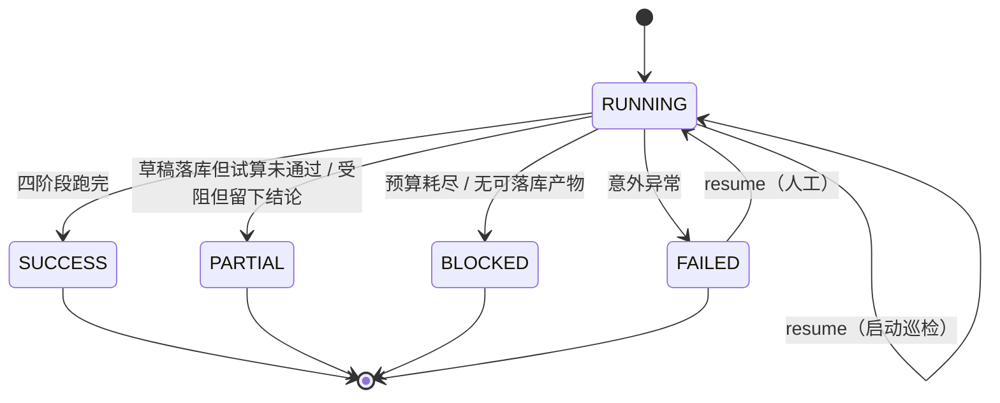

# 长任务的中间态恢复与启动巡检

> 适用代码：`agent/AgentOrchestrator#resume`、`agent/AgentRunRecovery`、`web/AgentRunController`、
> `rule/RunResumer`、`store/AgentRunRepository#goalJson|unfinishedRunIds`。
> 迁移：`docs/migrations/2026-10-27-agent-run-goal-json.sql`（回滚同名 `.rollback.sql`）。

## 一、要解决的问题

Agent 会话是**多步、有副作用**的：起草规则要问模型、影子试算要查生产表、跑对账要建任务。
进程被杀（发布、OOM、误杀）时，库里会留下三样东西：

- `recon_agent_run` 一行，状态卡在 `RUNNING`；
- `recon_agent_step` 若干行，能看到停在哪一步；
- 可能已经有**产物**：DRAFT 版本的规则、试算结论、对账任务。

以前只有两条路：从头再跑一遍（重复花模型预算、重复查生产表），或者人工看库手工补。
这两条都不该是唯一选项，所以加了第三条：**从最后一个持久化产物接着做**。

恢复的粒度按"产物"划，不按"步骤"划 —— 这是整篇文档的前提。中间变量（观测结果、规划 JSON）
没有落库，所以"第 5 步的上下文"恢复不了；但"草稿已经写进规则库"这件事恢复得了。

## 二、四个恢复点

判断只看轨迹里**最后一个 ACT**（PLAN 只是"打算怎么做"，崩在规划等于什么都没做）：

| 最后一个 ACT | 恢复点 | 接着做什么 | 为什么不从头 |
|---|---|---|---|
| 没有 / 只有 PLAN / `draft-round-N` | `SCRATCH` | 从头跑，**沿用同一个 runId 与步号** | 那一轮的草稿没落库，重起草是唯一选择 |
| `save-draft` | `DRAFT_SAVED` | 只补试算 + 沉淀 | 草稿已在库里；重起草可能给出另一个版本，把已审的那版挤掉 |
| `shadow-trial` | `TRIAL_DONE` | 只补沉淀 | 重跑试算会**多一条试算任务、多查一次生产表** |
| `run-reconciliation` | `JOB_DONE` | 只补归因 | 对账已经跑过；重跑会重复落差异行 |

`draft-round-N` 归到 `SCRATCH` 是有意的：它证明"模型跑过"，但那轮的输出没有落库，
既不能复用也不能当作已完成。

## 三、状态机



`resume` 只接受两种起点：`RUNNING`（进程崩了留下）与 `FAILED`（启动巡检标过）。
`SUCCESS / PARTIAL / BLOCKED` 一律 409 —— 它们是有结论的终点，重开会把结论搅乱。

## 四、一次恢复的时序

```
POST /api/agent/runs/7/resume        X-Operator: alice
  │
  ├─ AgentRunController（web 层，只依赖 rule.RunResumer）
  │
  └─ AgentOrchestrator.resume(7, "alice")
       1. 读 run            不存在 → 404；状态不是 RUNNING/FAILED → 409
       2. goalOf(run)       优先读 goal_json；NULL 才按 goal 文本重建
       3. resumePoint()     只看最后一个 ACT → SCRATCH / DRAFT_SAVED / TRIAL_DONE / JOB_DONE
       4. 先落一条轨迹      RESUME / from-<point>，状态 OK
       5. 分支              SCRATCH → 从执行段重跑；DRAFT_SAVED → 只补试算；
                            TRIAL_DONE / JOB_DONE → 直接进第 6 步
       6. conclude()        补归因 → 定终态 → finishRun
```

第 4 步**先写轨迹再动手**：恢复本身也是"被审计的行为"，中途再崩也留得下"有人救过、从哪救的"。

第 6 步是所有路径共用的 `conclude()`（原来的执行段收尾也走它）：
一处判终态，避免"正常跑完"和"恢复跑完"两套判断分叉。

## 五、为什么要存 `goal_json`

`goal` 列存的是人能读的那句话（`AgentGoal.describe()`）。真正决定行为的是 `AgentGoal` 里的
`intent`：`DRAFT_RULE` 与 `RUN_RECONCILIATION` 是两条完全不同的路。

如果恢复时只能靠文本猜 intent，**猜错就会让"只想起草"的会话真的跑一次生产对账**。
所以把结构化目标整份存下来（迁移 `2026-10-27-agent-run-goal-json.sql`）。

旧记录的 `goal_json` 是 NULL，退化规则是：
按文本重建，且 **intent 固定为 `DRAFT_RULE`** —— 万一原来是想跑对账的，恢复后也只是"少跑一次"，
不会"多跑一次"。

## 六、启动巡检

`agent/AgentRunRecovery` 在 `ApplicationReadyEvent` 之后做三件事：

1. `unfinishedRunIds()`：查 `status = 'RUNNING'` 的会话；
2. 有就起一个**单线程 daemon**，逐个 `resume(id, "startup-recovery")`；
3. 每个失败只 `WARN`，不影响应用健康，也不影响其它会话。

三个刻意的取舍：

- **不阻塞启动**：一次恢复可能要问模型几秒到几十秒，"端口能连"不该等它；
- **只接管"本进程启动之前"创建的 `RUNNING`**：端口在就绪事件之前就监听了，
  一条刚被本进程受理的会话很可能正在跑；不加这条时间线，恢复会跟它并行跑同一个会话
  （`AgentRunRecovery` 用 `processStart` 作界）；
- **串行**：同一条库连接上的写入按顺序来，比并发更像人操作，也更不容易撞唯一索引。

还有一个容易混淆的分工，这里写明：

| 组件 | 触发时机 | 干什么 |
|---|---|---|
| `TrialTaskRegistry`（ApplicationRunner） | 上下文就绪、端口已监听 | **只清点**遗留的 `QUEUED/RUNNING` 并留一条日志，不改状态 |
| `AgentRunRecovery`（ApplicationReadyEvent） | 应用完全起来之后 | 把启动前遗留的 `RUNNING` 逐个交给 `resume` |

上一版是 `TrialTaskRegistry` 直接把残留标 `FAILED`（超过 `stale-run-minutes` 的行）。
问题不在"标失败"本身，而在**它把已经落库的草稿、已经跑完的试算一起判成了没发生过** ——
那正是恢复要保住的东西。所以现在库层面干脆不再提供"强制失败"的入口
（`AgentRunRepository#failUnfinished` 已删除）；恢复失败时保持原状并记 `WARN`，
下次重启还能再试一轮，这个重试是**有界**的（每次启动最多一轮）。

人工救 `FAILED` 的入口就是那个 REST 接口 —— 自动与人工的分界线是"有没有人表过态"。

`FAILED` 现在的唯一来源是执行里真的抛了异常；它不会再被巡检"顺手标掉"。

## 七、终态语义：做了一半要如实说

`conclude()` 里有一条判定：

```
草稿已落库（draftVersion != null） 且 试算没通过（verdict != PASS）  →  PARTIAL
```

以前这里无条件写 `SUCCESS`。实测撞到过一次：H2 不认 `CRC32`，每条分片都 FAILED，
结论是 `INCONCLUSIVE`，而会话报 `SUCCESS` —— 下游（人、脚本、审批）会以为"已经验过了"。

`PARTIAL` 的含义就一句：**有产物、有结论，但没验证通过，别当成可用**。
BLOCKED 是"什么都没做出来"，SUCCESS 是"做完了且验过了"，三者不混。

## 八、数据与迁移

| 变更 | 说明 | 回滚 |
|---|---|---|
| `recon_agent_run.goal_json TEXT NULL` | 结构化目标（恢复用） | `2026-10-27-agent-run-goal-json.rollback.sql` |

迁移脚本用 `information_schema` 判存在性后再 `ALTER`，可重复执行；
回滚脚本同样幂等，列不存在时什么都不做。

**顺序要求**：回滚库之前先把代码回到旧版本。新代码写 `goal_json`，列没了会直接报
`Unknown column` —— 那比不回滚更糟。

数据影响：回滚只让"恢复时记住原意图"这个能力消失，已跑完的会话与轨迹不受影响。

## 九、边界（明确不做的事）

- **不做步级 checkpoint**：粒度就是"落库的产物"。硬做步级快照，等于把中间变量也变成持久化契约；
- **不自动救 `FAILED`**：见第六节，自动重试会把"一直失败"变成"每次重启撞一次"；
- **不做多实例租约**：两个进程同时 `resume` 同一会话会互相覆盖，当前部署边界是单实例单租户
  （`docs/architecture.md` 已写明）；
- **`SCRATCH` 会重复花模型预算**：这是恢复的代价，不是 bug；预算与实际 token 都会照常记账。

## 十、验证

单测（`AgentOrchestratorTest`，11 个用例，其中 3 个是恢复）：

| 用例 | 断言 |
|---|---|
| `resumePointFollowsTheLastActionThatLeftAnArtifact` | 四个恢复点按最后 ACT 正确映射（含空轨迹 → SCRATCH） |
| `resumeRefusesARunThatAlreadyReachedAVerdict` | 已 `BLOCKED` 的会话 → `IllegalStateException`（HTTP 409） |
| `resumeFromSavedDraftOnlyRepeatsTheTrial` | 只补试算不重起草；`INCONCLUSIVE` → `PARTIAL`；轨迹留下 `RESUME / from-draft_saved` |

实现过程中被这些用例抓到一个真 bug：`goalJson` 对可空列直接 `stream().findFirst()`，
`Optional` 装不下 null → NPE。修法是先滤空。

### 实测 A：进程中断 → 启动巡检自动接管（2026-10-27，H2 文件库 + 桩模型）

为了让"杀掉进程"可复现，用了文件库而不是内存库
（`--spring.datasource.url=jdbc:h2:file:./work/recon-resume;...`），桩模型故意返回非 JSON。

1. 起草一次 → 会话 `#1` 停在 `BLOCKED`，轨迹 5 行：
   `1 OBSERVE / 2 PLAN(draft_rule) / 3–5 ACT(draft-round-1..3) INVALID_JSON`
2. 停应用，用 H2 Shell 把 `status` 改成 `RUNNING`（等价于"进程在跑的时候被杀了"）。
3. **重启应用，没有任何人调接口** —— 巡检在就绪后自动接管，轨迹变成 11 行：

```
  6 RESUME / from-scratch                      OK
    payload: 没有可复用的产物（上次停在感知/规划/起草），从头重跑；沿用同一个会话号与步号
  7 OBSERVE / inspect-rule-library             OK
  8 PLAN    / draft_rule                       OK
  9-11 ACT  / draft-round-1..3                 INVALID_JSON
```

4. 终态仍是 `BLOCKED`。桩模型给的不是 JSON，重跑三轮回合同样失败 ——
   **恢复不是"一定能救活"**，它是"不丢掉已经证明的东西，并且如实记下为什么还停在原地"。
   两点值得注意：步号从 6 接着走（没有第二条 `1`，唯一索引 `uk_agent_step` 也没被撞），
   恢复点判定把"停在起草轮次"正确归到 `SCRATCH`。

5. 改成"`TrialTaskRegistry` 只清点、恢复交给 `AgentRunRecovery`"之后又复验了一次：
   同一条会话再次置 `RUNNING` 并重启 → 轨迹追加 `12 RESUME / from-scratch`，总步数 17，
   状态仍如实 `BLOCKED`。没有任何人调接口，也没有任何"标失败"，它自己接着把那段跑完了。

### 实测 B：人工入口的三种拒绝（同一实例，curl）

| 请求 | 响应 |
|---|---|
| `POST /api/agent/runs/999999/resume`（带 `X-Operator`） | `404` `{"error":"not_found","message":"没有这个会话：#999999"}` |
| `POST /api/agent/runs/1/resume`（已 `BLOCKED`） | `409` `{"error":"not_resumable","message":"会话 #1 已经结束（BLOCKED）：只有 RUNNING（进程中断）或 FAILED（被启动巡检标记）的会话能恢复；出了结论的会话重跑会把结论搅乱"}` |
| 同上去掉 `X-Operator` | `400` `Bad Request` |

全量：**817 tests / 0 failures**（含 `AgentOrchestratorTest` 的三条恢复用例）。
正向路径（`DRAFT_SAVED` 只补试算）以单测为准 —— 造"试算已落库但沉淀中断"的现场
需要卡在两次写库之间，live 不方便复现，这一点如实写在这里。

## 十一、运维手册

- **先看有没有没跑完的**：`SELECT id, goal, status FROM recon_agent_run WHERE status = 'RUNNING'`
  （启动巡检会自动接管；手工查只是确认）
- **救一个 `FAILED` 的**：`POST /api/agent/runs/{id}/resume`，带 `X-Operator`
- **看它到底做了什么**：`GET /api/audit/runs/{id}`（要 `X-Operator` + 配了密钥时的 `X-Api-Key`），
  轨迹里 `phase=RESUME` 那行的 `payload` 写着"从哪接着做、为什么"
- **回滚**：先回代码，再跑 `.rollback.sql`
